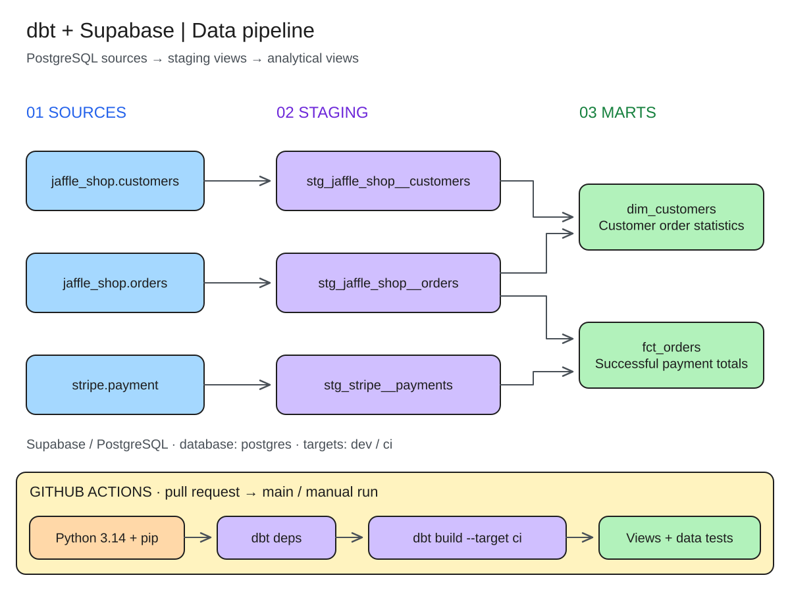

# dbt_Supabase

dbt project for transforming Jaffle Shop and Stripe data in PostgreSQL on Supabase. Three staging models prepare customers, orders, and payments, while two marts aggregate order statistics and successful payment totals. All models are materialized as **views**.

## Pipeline



The diagram was created in Excalidraw. Use **Open** in Excalidraw to open the [editable source](docs/diagrams/pipeline.excalidraw); the [SVG](docs/diagrams/pipeline.svg) is displayed in this README. When changing the pipeline, update both the source and the SVG export.

Source data is loaded separately and manually. The project reads existing tables; the repository contains no data loading scripts or populated seeds.

### Sources and models

Sources are declared in the `postgres` database:

| Source | Required columns for the models | Staging model |
| --- | --- | --- |
| `jaffle_shop.customers` | `id`, `first_name`, `last_name` | `stg_jaffle_shop__customers` |
| `jaffle_shop.orders` | `id`, `user_id`, `order_date`, `status` | `stg_jaffle_shop__orders` |
| `stripe.payment` | `id`, `orderid`, `paymentmethod`, `status`, `amount`, `created` | `stg_stripe__payments` |

Staging standardizes field names. The payments model divides the source amount in cents by `100`; the actual precision of the result depends on the source column type in PostgreSQL. In the customer and order staging models, the `add_etl_timestamp_local()` macro adds `etl_timestamp_local` using `CURRENT_TIMESTAMP`. Because these models are views, this value is evaluated when queried within the current transaction, rather than recording when the data was loaded.

| Mart | Dependencies | Output |
| --- | --- | --- |
| `dim_customers` | Staged customers and orders | Customer, first and most recent order dates, and order count; the count is `0` for customers with no orders |
| `fct_orders` | Staged orders and payments | Order, customer, date, and total payments with a `success` status; the total is `0` when there are no successful payments |

## Running locally

Run the following PowerShell commands from the repository root. GitHub Actions uses Python **3.14**; dependencies are pinned in [requirements.txt](requirements.txt), including `dbt-core==1.12.5` and `dbt-postgres==1.11.0`.

### 1. Prepare the environment

```powershell
py -3.14 -m venv dbt_venv
.\dbt_venv\Scripts\Activate.ps1
python -m pip install --upgrade pip
python -m pip install -r requirements.txt
```

### 2. Configure the connection

[profiles.yml](profiles.yml) reads settings from environment variables and contains no credentials:

```powershell
$env:DBT_PROFILES_DIR = (Get-Location).Path
$env:DBT_HOST = '<PostgreSQL host from your Supabase settings>'
$env:DBT_DBNAME = 'postgres'
$env:DBT_USER = '<PostgreSQL user>'
$dbtPassword = Read-Host 'PostgreSQL password' -AsSecureString
$env:DBT_PASS = [System.Net.NetworkCredential]::new('', $dbtPassword).Password
```

Password input is hidden, and the password is passed to dbt through the current process environment. Git ignores `.env` files, but this project does not load them automatically.

Both targets use port **5432** and four threads. Choose a PostgreSQL host reachable from your machine. The database user needs read access to the source tables and permission to create the schema and views for the selected target.

| Target | Output schema | Purpose |
| --- | --- | --- |
| `dev` | `dev` | Local development; the default target |
| `ci` | `ci` | Builds and tests in GitHub Actions |

`DBT_DBNAME` must match the source database, which is explicitly set to `postgres` in the current YAML definitions.

### 3. Build the project

First, create and populate the source tables listed in the "Sources and models" section.

```powershell
dbt deps
dbt debug
dbt build --target dev
```

`dbt deps` installs the packages from [packages.yml](packages.yml): `dbt_utils` 1.3.0, `dbt_expectations` 0.10.4, and `dbt_date` 0.10.1. `dbt debug` checks the connection, and `dbt build` creates views and runs tests in dependency order.

Useful commands after configuring the environment:

```powershell
# Staging models only
dbt build --select tag:staging --target dev

# Marts and their staging dependencies
dbt build --select +tag:mart --target dev

# Tests for models that have already been built
dbt test --target dev

# Local HTML documentation and dependency graph
dbt docs generate --target dev
dbt docs serve
```

## Data quality checks

Tests are defined alongside the models in YAML and separately in the `tests/` directory:

- Unique, non-`NULL` identifiers in the staging models and `dim_customers`.
- Non-`NULL` values in `order_id`, `customer_id`, and `order_date`, and uniqueness of their combination in `fct_orders`.
- Accepted order statuses: `placed`, `shipped`, `completed`, `return_pending`, `returned`.
- Referential integrity between `customer_id` in staged orders and customers.
- Non-negative total payments per order, checked by the SQL test [assert_positive_total_for_payments.sql](tests/assert_positive_total_for_payments.sql).

The `jaffle_shop.orders` source also has a freshness check on the `created_date` column: a warning after 12 hours and an error after 24 hours. This check runs **separately** and requires that column to exist in the source table:

```powershell
dbt source freshness --target dev
```

## GitHub Actions

### dbt build

The [dbt.yml](.github/workflows/dbt.yml) workflow runs on pull requests targeting `main` and manually through `workflow_dispatch`:

1. Checks out the code and sets up Python 3.14 on Ubuntu.
2. Installs dependencies from `requirements.txt` in a virtual environment.
3. Runs `dbt deps`.
4. Runs `dbt build --target ci` to create views and run tests in the `ci` schema.

Add the following repository secrets in GitHub Actions to configure the connection:

| Secret | Value |
| --- | --- |
| `DBT_HOST` | PostgreSQL host reachable from the GitHub Actions runner |
| `DBT_DBNAME` | `postgres` for the current source definitions |
| `DBT_USER` | PostgreSQL user |
| `DBT_PASS` | User password |

All runs share the `ci` schema, so the workflow runs them sequentially using the `dbt-ci` concurrency group with `cancel-in-progress: false`. CI builds leave the `dev` schema unchanged. Scheduled runs, source freshness checks, and dbt documentation publishing are not configured in this workflow.

### Code checks

The [pre-commit.yml](.github/workflows/pre-commit.yml) workflow runs on pull requests targeting `main` and pushes to `main`. It installs the tools, generates `target/manifest.json` using `dbt deps` and `dbt parse` with a dummy profile and no database connection, then passes the file list from `git diff --name-only origin/main` to pre-commit. Checks are skipped if the list is empty.

The [pre-commit configuration](.pre-commit-config.yaml) includes YAML and whitespace checks, Prettier for YAML, Black and Flake8 for Python, sqlfmt for SQL, and dbt-checkpoint to check model and macro descriptions and the presence of `not_null` and uniqueness tests.

To run these checks locally in an activated `dbt_venv`, install the additional dependencies as in CI:

```powershell
python -m pip install --no-deps "git+https://github.com/dbt-checkpoint/dbt-checkpoint@v2.0.4"
python -m pip install --no-deps mixpanel
python -m pip install httpx asgiref json-logic==0.7.0a0
pre-commit install --install-hooks
dbt deps
dbt parse
pre-commit run --all-files
```

Git is required to install dbt-checkpoint from GitHub. The package is installed with `--no-deps` because of mixpanel's pydantic version constraint, as described in the workflow. Local dbt-checkpoint hooks use the activated environment and the generated manifest.

## Repository structure

```text
.github/workflows/     dbt builds and pre-commit checks
docs/diagrams/         Pipeline diagram: Excalidraw and SVG
models/
  staging/jaffle_shop/ Customer and order sources and staging models
  staging/stripe/      Payment source and staging model
  mart/                dim_customers and fct_orders marts
macros/                Timestamp macro and its description
tests/                 SQL test for total payments
analyses/              Directory for analytical queries; currently empty
seeds/                 Directory for CSV data; currently empty
snapshots/             Directory for snapshots; currently empty
dbt_project.yml        Project settings, materializations, and tags
profiles.yml           dev and ci connections via environment variables
packages.yml           dbt packages
package-lock.yml       Locked dbt package versions
requirements.txt       Python dependencies
```

Generated directories `target/`, `dbt_packages/`, and `logs/`, as well as virtual environments, are excluded from Git.
